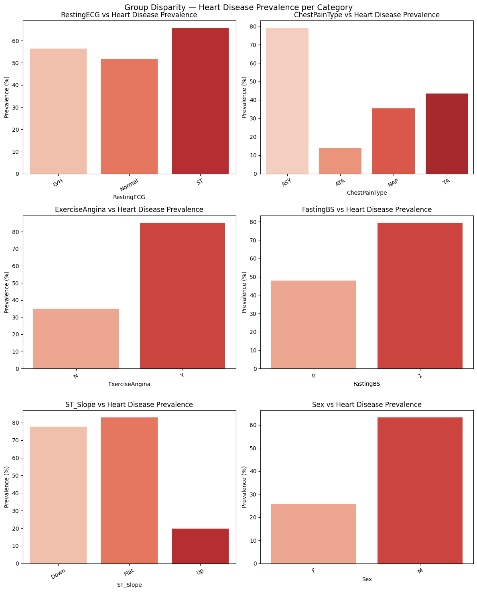
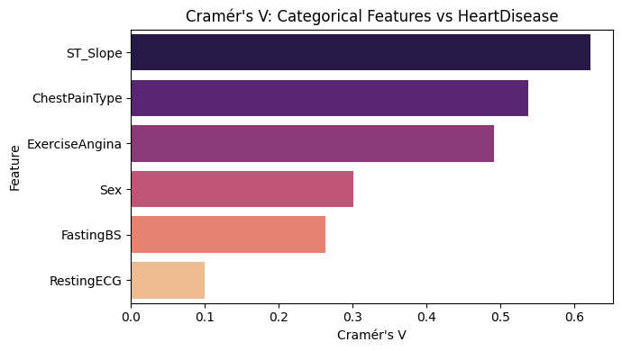
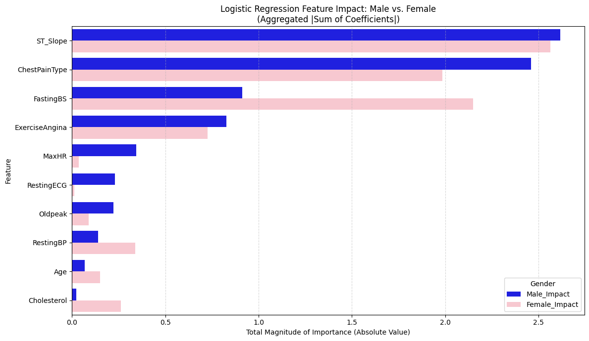

# Gender-Aware Cardiovascular Disease Prediction


A research internship (Forschungspraktikum) project from the M.Sc. Web and Data Science program at the University of Koblenz (March 2026). We train standard classifiers to predict heart disease, show that they miss far more sick women than sick men, and test several ways to close that gap. The work covers data-level, algorithm-level and feature-level fixes, and evaluates every model separately for male and female patients.

## Motivation

Women are underrepresented in clinical cardiovascular data, so prediction models learn mostly from male patients. A model can look accurate overall while missing many female patients who do have heart disease. In medicine, a missed diagnosis (false negative) is the costliest mistake. This project measures that gap and tries to reduce it.

## Dataset

**Heart Failure Prediction Dataset** by fedesoriano, published on Kaggle in September 2021 ([link](https://www.kaggle.com/datasets/fedesoriano/heart-failure-prediction)). It combines five heart disease datasets that originally come from the UCI Machine Learning Repository (Cleveland, Hungarian, Switzerland, Long Beach VA and Stalog).

- **Size:** 918 patients, 11 features and 1 target
- **Sex split:** 725 male (79%) and 193 female (21%)
- **Target:** `HeartDisease` (1 = heart disease, 0 = normal): 508 positive and 410 negative

| Feature | Type | Description |
|---|---|---|
| `Age` | numeric | Age in years |
| `Sex` | categorical | M / F (the sensitive attribute) |
| `ChestPainType` | categorical | TA (typical angina), ATA (atypical angina), NAP (non-anginal pain), ASY (asymptomatic) |
| `RestingBP` | numeric | Resting blood pressure (mm Hg) |
| `Cholesterol` | numeric | Serum cholesterol (mg/dl) |
| `FastingBS` | binary | 1 if fasting blood sugar > 120 mg/dl, else 0 |
| `RestingECG` | categorical | Normal, ST (ST-T wave abnormality), LVH (left ventricular hypertrophy) |
| `MaxHR` | numeric | Maximum heart rate achieved |
| `ExerciseAngina` | categorical | Exercise-induced angina (Y / N) |
| `Oldpeak` | numeric | ST depression (oldpeak) |
| `ST_Slope` | categorical | Slope of the peak exercise ST segment (Up, Flat, Down) |
| `HeartDisease` | target | 1 = heart disease, 0 = normal |

## Methodology

- **Preprocessing:** treat zero values in `Cholesterol` and `RestingBP` as missing and fill them with the median for each sex. Detect outliers (IQR and Isolation Forest) and check winsorization. Apply a Yeo-Johnson transform to the skewed numeric features, one-hot encode the categorical ones, and make a stratified 80/20 train/test split.
- **Baseline models:** Logistic Regression, Random Forest, SVM (RBF), Decision Tree and Gradient Boosting, each evaluated overall and per sex.
- **Bias detection (EDA):** univariate and bivariate analysis, heart disease prevalence per category, mutual information, Cramér's V, and feature importance computed separately for men and women (LR coefficients and RF importances).
- **Bias mitigation** (on Logistic Regression and Random Forest):
  - Random oversampling of female records
  - SMOTE applied to female records only
  - Fairness-aware sample reweighting (boosting female positive cases)
  - Fairlearn Exponentiated Gradient with Demographic Parity and Equalized Odds constraints
  - AIF360-style reweighing on clinical features
  - Sex-specific models: female-only models and reduced feature sets ("Pushing-4": Age, Cholesterol, FastingBS, ST_Slope; "Top-4": ST_Slope, ChestPainType, ExerciseAngina, FastingBS)
- **Metrics:** accuracy, precision, recall and F1, plus fairness metrics: recall per sex, the **Equal Opportunity (EO) gap** (the absolute difference in recall between men and women), the Demographic Parity gap and the false positive rate gap.

## Results

### Baseline (all patients)

Logistic Regression and Random Forest had the highest recall, so they were carried forward.

| Model | Accuracy | Precision | Recall | F1 |
|---|---|---|---|---|
| Logistic Regression | 0.89 | 0.90 | 0.89 | 0.90 |
| Random Forest | 0.88 | 0.88 | 0.91 | 0.89 |
| SVM (RBF) | 0.85 | 0.86 | 0.87 | 0.87 |
| Decision Tree | 0.80 | 0.82 | 0.82 | 0.82 |
| Gradient Boosting | 0.86 | 0.89 | 0.86 | 0.88 |

Good overall numbers hide a gap: baseline **female recall is 0.50 (LR) and 0.67 (RF)**, compared with 0.92 and 0.93 for men.

### Baseline vs. mitigated: recall by sex

Source: report, Tables 6.2 and 6.3. An EO gap closer to 0 means the model is fairer.

| Strategy | LR male recall | LR female recall | LR EO gap | RF male recall | RF female recall | RF EO gap |
|---|---|---|---|---|---|---|
| Baseline | 0.92 | 0.50 | 0.42 | 0.93 | 0.67 | 0.26 |
| Random oversampling | 0.90 | 0.67 | 0.23 | 0.93 | 0.67 | 0.26 |
| Female-only SMOTE | 0.91 | 0.83 | 0.08 | 0.90 | 0.83 | 0.07 |
| Fairness reweighting | 0.86 | 0.83 | 0.03 | 0.92 | 0.83 | 0.09 |
| Fairlearn: Demographic Parity\* | 0.84 | 0.83 | 0.01 | 0.93 | 1.00 | 0.07 |
| Fairlearn: Equalized Odds\* | 0.86 | 0.83 | 0.03 | 0.94 | 0.67 | 0.27 |
| AIF360-style reweighing | 0.80 | 0.67 | 0.13 | 0.92 | 0.83 | 0.09 |
| Pushing-4 features (pooled, 5-fold CV) | 0.86 | 0.89 | 0.03 | 0.83 | 0.91 | 0.08 |
| Top-4 features (pooled, 5-fold CV) | 0.88 | 0.84 | 0.04 | 0.88 | 0.80 | 0.08 |

\* Fairlearn's `ExponentiatedGradient` makes randomized predictions, so results change slightly between runs. In the saved notebook outputs, the Logistic Regression rows read: Demographic Parity female recall 1.00, male 0.84 (EO gap 0.16); Equalized Odds female 0.83, male 0.88 (EO gap 0.04). The Random Forest rows match the report.

**Key findings**

- Overall metrics hide the bias. The baseline LR misses about half of the women with heart disease.
- Every strategy except random oversampling (for RF) and Fairlearn Equalized Odds (for RF) improved female recall, typically from 0.50–0.67 up to 0.83.
- Fairness reweighting and female-only SMOTE gave the most consistent gains across both models.
- Feature-guided models (Pushing-4) reached the highest female recall (0.89 for LR, 0.91 for RF) with small EO gaps, and they are easy to interpret.
- Demographic Parity and some SMOTE settings pushed female recall to 1.00, which suggests overcompensation, likely at the cost of more false positives.

> **Caveat:** the test split contains only 38 women, 6 of whom have heart disease, so each female recall step (0.50 → 0.67 → 0.83 → 1.00) is one patient. Treat these numbers as indicative. See the report (Section 7.2) for the full list of limitations.

### Selected plots

**Heart disease prevalence per category.** Women in this dataset have a much lower prevalence than men.



**Cramér's V: categorical features vs. HeartDisease**



**Logistic Regression feature impact, male vs. female model.** For example, `FastingBS` matters much more for women.



## How to run

```bash
git clone https://github.com/mvskpranav11/CVD-Gender-Bias.git
cd CVD-Gender-Bias
pip install -r requirements.txt
jupyter notebook notebooks/CVD_Analysis_Final.ipynb
```

The notebook reads the data from `../data/heart999.csv`, so start Jupyter from the repository root (or from `notebooks/`). The saved outputs are kept, so you can also browse the results directly on GitHub.

## Repository structure

```
CVD-Gender-Bias/
├── README.md
├── requirements.txt
├── LICENSE
├── data/
│   └── heart999.csv               # Heart Failure Prediction Dataset (Kaggle)
├── notebooks/
│   └── CVD_Analysis_Final.ipynb   # Full analysis with outputs
├── report/
│   └── CVD_Report_Final.pdf       # Final project report (87 pages; student IDs removed from title page)
└── images/                        # Plots used in this README
```

## Team & acknowledgements

This was a team project by 11 students in the M.Sc. Web and Data Science program, University of Koblenz:

Akhil Daggu · Amrutha Korada · Karunasagar · Rakshitha Ramya Sadanand · Raju Yadav Narmala · Sarvani Reddy Yalam · Suprit Sanjeev Vaidya · Tejas Mahendra Chaudhari · Tejaswi Mudunuri · **Venkata Sesha Krishna Pranav Manuguri** · Yashwanth Chenna Reddy Gotike

I (Venkata Sesha Krishna Pranav Manuguri) was a member of this team. This repository is my personal copy of our joint work.

**Supervisors:** Prof. Dr. Andreas Mauthe (first examiner) and Christopher Latz, M.Sc. (second examiner), Institut für Wirtschafts- und Verwaltungsinformatik, FG Mauthe, University of Koblenz.

**Original team repository:** [github.com/research903/CVD](https://github.com/research903/CVD)

**Dataset citation:** fedesoriano (September 2021). *Heart Failure Prediction Dataset.* Retrieved from https://www.kaggle.com/datasets/fedesoriano/heart-failure-prediction

## License

The code is released under the [MIT License](LICENSE). The dataset (`data/`) keeps its own license (ODbL v1.0 for the database, contents © the original authors), and the report (`report/`) remains © its authors. See [LICENSE](LICENSE) for details.
